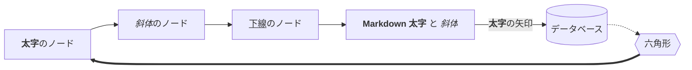
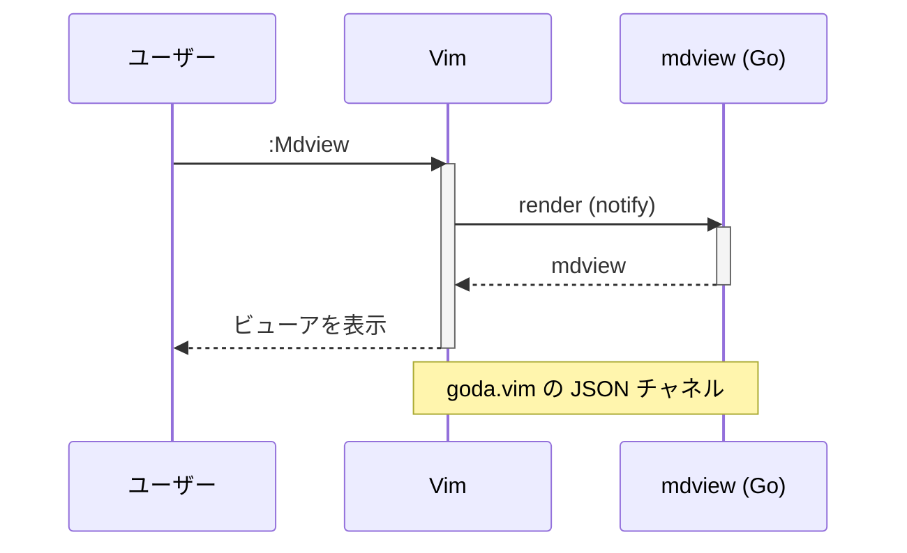
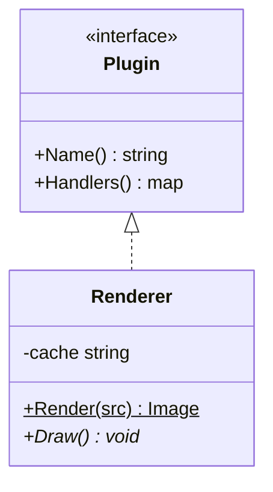
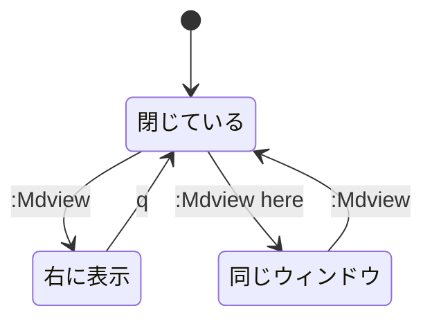
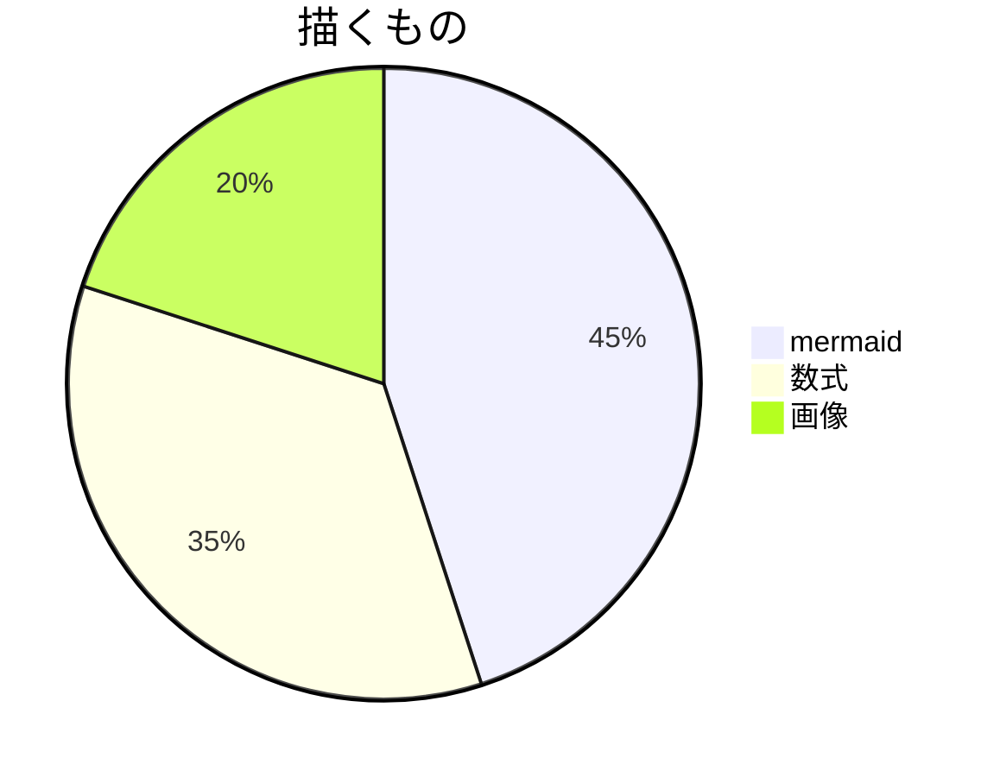
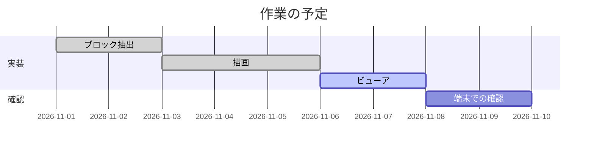
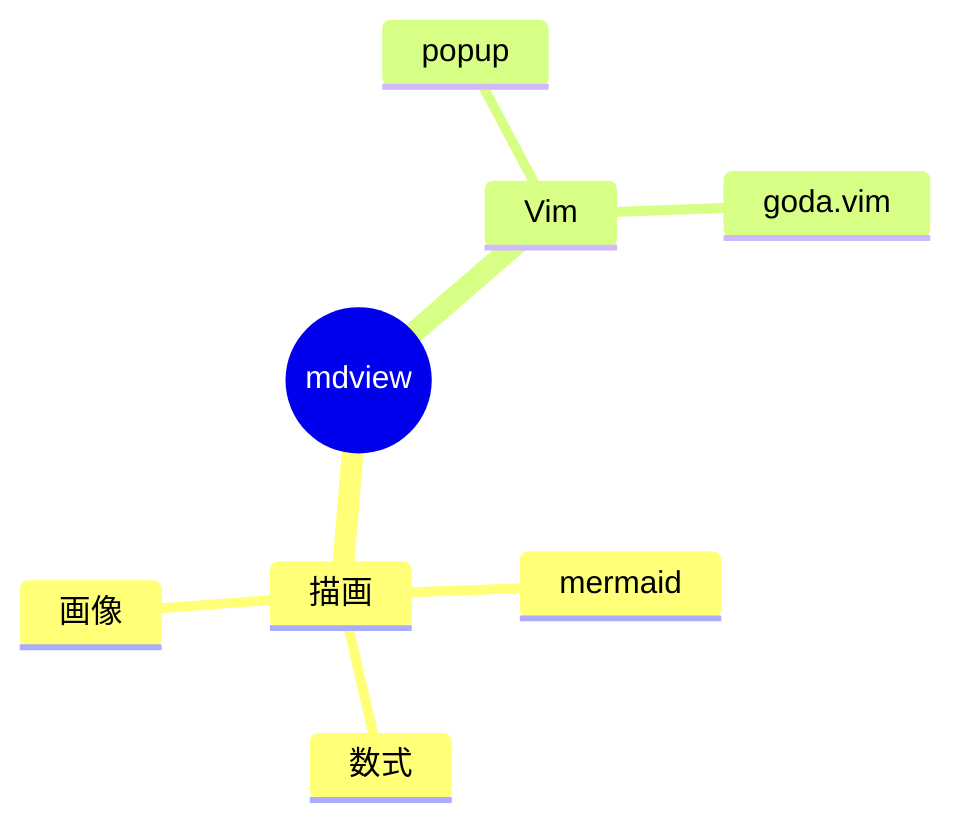

# mdview 総合テスト

Markdown の書式、mermaid、数式、画像をまとめて確認するためのファイルです。
`:Mdview` で右に、`:Mdview here` で同じウィンドウに開きます。

## 1. 文字の書式

- 通常: The quick brown fox jumps over the lazy dog. いろはにほへと。
- 太字: **bold text** と __bold text__、**日本語の太字**
- 斜体: *italic text* と _italic text_、*日本語の斜体*
- 太字の斜体: ***bold italic*** と ___bold italic___
- 太字の中の斜体: **bold with *italic* inside**
- 取り消し線: ~~strikethrough~~、~~取り消し線~~
- 下線（HTML）: <u>underlined text</u>、<u>日本語の下線</u>
- 下線の中の太字・斜体: <u><b>underline bold</b></u>、<u><i>underline italic</i></u>
- HTML の太字・斜体: <b>b tag</b> <strong>strong tag</strong> <i>i tag</i> <em>em tag</em>
- インラインコード: `let x = 1` と `**not bold**`
- エスケープ: \*not italic\* と \_not italic\_
- 単語の中の下線: snake_case_name は斜体にならない
- リンク（`<CR>` か `gx` で開く）: [mdview のヘルプ](../doc/mdview.txt) と <https://example.com>
- 見出しへのリンク: [4. mermaid へ](#4-mermaid) と [別の文書の見出し](nested.md#画像)、画像のファイル: [gradient.png](gradient.png)
- インライン数式（1 行のテキストにする）: $E = mc^2$ と $\alpha + \beta$ と $\frac{a+b}{c}$

段落の中の改行は
つなげて、ビューアの幅で折り返します。日本語の文字どうしは
空白を入れずに、English words
are joined with a space.
行末の空白 2 つで改行します。  
行末の \ でも改行します。\
タグの<br>でも改行します。

## 2. 見出し

### 見出し 3
#### 見出し 4
##### 見出し 5
###### 見出し 6

見出し 1（Setext）
================

見出し 2（Setext）
----------------

## 3. ブロック要素

> 引用です。**太字**と*斜体*も入ります。
> 2 行目の引用です。
>
> > 入れ子の引用です。

> 引用の中の画像と表とコードブロック:
>
> 
>
> | 引用の中 | 画像 |
> |---|---|
> | x |  |
>
> ```sh
> > これはコードの中の > なので縦線にしない
> ```
>
> この段落の
続きの行（> の無い行）も引用の中ですが、縦線は付けません。

- リストの中の
  > 引用です。

> [!NOTE]
> アラートの本文は薄くしません。

> [!TIP]
> 便利な使い方。

> [!IMPORTANT]
> 大事なこと。

> [!WARNING]
> 注意が必要なこと。

> [!CAUTION]
> 危ないこと。

1. 番号付きリスト
2. 2 番目
   1. 入れ子の番号
   2. 入れ子の 2 番目
3. 3 番目

- 箇条書き
  - 入れ子
    - さらに入れ子
- [ ] 未完了のタスク
- [x] 完了したタスク

| 左寄せ | 中央 | 右寄せ |
|:-------|:----:|-------:|
| **太字** | *斜体* | `code` |
| <u>下線</u> | ~~取消~~ | 123 |

長いセルは列の幅で折り返されます（ビューアの幅を狭めて確かめる）。

| 項目 | 説明 | 備考 |
|------|------|------|
| 折り返し | ウィンドウの幅に収まらない表は、列を縮めてセルの中で折り返します。英語の文 also wraps at spaces like this one. | `<br>` で<br>改行 |
| エスケープ | `a \| b` と a \| b | [リンク](https://example.com) |
| 数式 | $E = mc^2$ と $\alpha + \beta$ | 次の行は列が足りない |
| 足りない |
| 画像 |  | 画像はセルの中に描きます |
| 2 枚と文字 |  と  | 縦に並びます |

> | 引用の中 | 表 |
> |---|---|
> | 1 | 2 |

---

水平線は `---` のほかに `***` と `___` も使えます（上の見出し 2 の下線は水平線ではありません）。

***

> 引用の中の水平線:
>
> ---

___

```go
// コードブロックは枠で囲み、言語の色を付けます（タブは空白に展開）。
func main() {
	fmt.Println("**ここは太字にならない**")
}
```

```diff
- 行頭の記号も diff の色になります
+ 縦線は仮想テキストなので
  構文は中身だけを見ます
```

~~~sh
# ~~~ のフェンスと、別名（sh）
echo "$HOME" | grep -c x
~~~

> ```py
> # 引用の中のコードブロック（py は python の別名）
> def f(x):
>     return x * 2
> ```

```
$$ コードブロックの中の数式は描かない $$

```

## 4. mermaid

### 4.1 flowchart（ラベルの書式）



### 4.2 sequenceDiagram



### 4.3 classDiagram（static と abstract）



### 4.4 stateDiagram



### 4.5 pie



### 4.6 gantt



### 4.7 mindmap



## 5. 数式

### 5.1 太字・斜体・下線

$$
\mathbf{v} = \boldsymbol{\alpha}\,\mathit{x} + \underline{y} + \textbf{太字} + \textit{italic} + \text{日本語}
$$

### 5.2 分数・総和・積分

$$
\sum_{i=1}^{n} \frac{1}{i^2} \;\to\; \frac{\pi^2}{6},
\qquad
\int_0^\infty e^{-x^2}\,dx = \frac{\sqrt{\pi}}{2}
$$

### 5.3 行列と場合分け

$$
A = \begin{pmatrix} a_{11} & a_{12} \\ a_{21} & a_{22} \end{pmatrix},
\quad
|x| = \begin{cases} x & (x \ge 0) \\ -x & (x < 0) \end{cases}
$$

### 5.4 揃え

$$
\begin{aligned}
(a+b)^2 &= a^2 + 2ab + b^2 \\
(a-b)^2 &= a^2 - 2ab + b^2
\end{aligned}
$$

### 5.5 1 行の書き方と \[ \]

$$ e^{i\pi} + 1 = 0 $$

\[ \nabla \cdot \mathbf{E} = \frac{\rho}{\varepsilon_0} \]

### 5.6 math のコードブロック

```math
\overbrace{1 + 2 + \cdots + n}^{n \text{ 個}} = \frac{n(n+1)}{2}
```

## 6. 画像


行の途中の画像  は描きません。

## 7. エラーの表示

```mermaid
flowchart TD
  A -->
```

$$
\frac{1}{
$$

## 8. 長い文章（スクロールの確認）

吾輩は猫である。名前はまだ無い。どこで生れたかとんと見当がつかぬ。何でも薄暗いじめじめした所でニャーニャー泣いていた事だけは記憶している。**吾輩はここで始めて人間というものを見た。** しかもあとで聞くとそれは書生という人間中で一番獰悪な種族であったそうだ。*この書生というのは時々我々を捕えて煮て食うという話である。*

Lorem ipsum dolor sit amet, **consectetur adipiscing elit**, sed do *eiusmod tempor* incididunt ut <u>labore et dolore</u> magna aliqua. Ut enim ad minim veniam, quis nostrud exercitation ullamco laboris nisi ut aliquip ex ea commodo consequat.

最後の行の数式:

$$ \lim_{n\to\infty} \left(1 + \frac{1}{n}\right)^n = e $$
